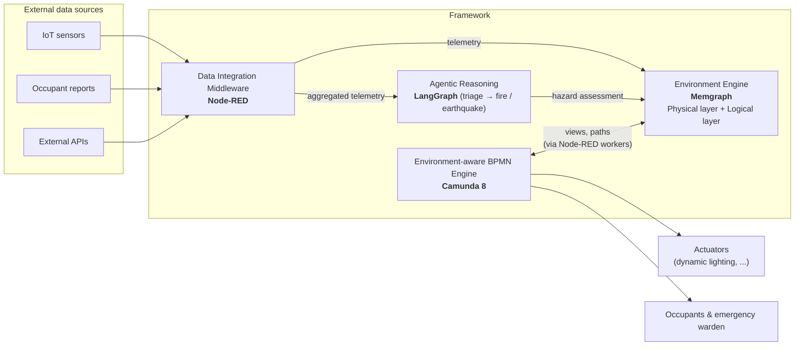
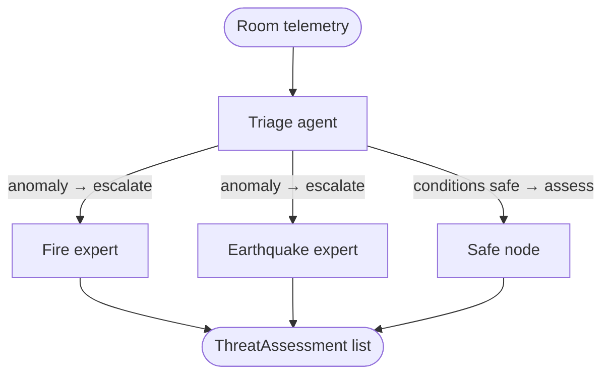

<div align="center">

# Adaptive Multi-Hazard Emergency Response Framework for Indoor Environments

Graph-based building model · IoT telemetry · LLM multi-agent hazard detection · environment-aware BPMN orchestration

[](https://www.python.org/)
[](https://docs.astral.sh/uv/)
[](https://github.com/langchain-ai/langgraph)
[](https://camunda.com/)
[](https://memgraph.com/)
[](https://redis.io/)
[](https://nodered.org/)
[](https://www.docker.com/)
[]()
[]()

</div>

> **Research prototype.** This is the reference implementation of a Master's thesis (see [About the thesis](#about-the-thesis)). It is **not** a certified safety system and must not be used as the sole safety mechanism of a real building. Human oversight, security hardening, fault tolerance and regulatory compliance (e.g. NFPA 101) are explicitly out of scope of the current version (see [Limitations](#limitations)).

---

## Table of contents

- [Overview](#overview)
- [Research questions](#research-questions)
- [Architecture](#architecture)
- [How it works](#how-it-works)
- [Components](#components)
  - [Data Integration Middleware (Node-RED)](#1-data-integration-middleware-node-red)
  - [Emergency Agent (LangGraph)](#2-emergency-agent-langgraph)
  - [Environment Engine (Memgraph)](#3-environment-engine-memgraph)
  - [Environment-aware BPMN Engine (Camunda)](#4-environment-aware-bpmn-engine-camunda)
- [Evaluation](#evaluation)
- [Limitations](#limitations)
- [Future work](#future-work)
- [Getting started](#getting-started)
- [Project structure](#project-structure)
- [About the thesis](#about-the-thesis)
- [License](#license)

---

## Overview

Most buildings still rely on **static evacuation routes**: printed maps and fixed signage that cannot change once an emergency starts. If smoke fills a corridor or a hazard blocks an exit, the route stays the same and, in the worst case, leads people straight into the danger.

This project explores an **adaptive** alternative that reacts to hazards *as they develop*:

1. The building is modeled as a **graph** (rooms, corridors, exits, stairs) stored in a graph database, with static attributes (geometry, BIM-ready metadata) and dynamic attributes coming from **IoT sensors**.
2. A **Multi-Agent System** of LLM-based agents interprets the incoming telemetry, classifies hazards (currently **fire** and **earthquake**) and writes the result back onto the graph, marking places as unsafe.
3. An **environment-aware BPMN engine** defines, separately for each actor (security system, occupants, emergency warden), what must happen once a hazard is confirmed. It queries the graph for safe evacuation routes and drives physical actuators such as **dynamic directional lighting**.

The prototype was built and evaluated on a real building: **Department A of the Computer Science division, University of Camerino** (21 places, 104 directed `CONNECTED_TO` edges, two floors connected by stairs).

**Headline result:** across all tested scenarios the framework produced **100% hazard-free routes** (HFR = 100%), at the cost of a longer path when the shortest one is no longer safe. With no hazard, it behaves exactly like static routing.

---

## Research questions

| # | Question | Status |
|---|----------|--------|
| **RQ1** | Can specialized AI agents reliably turn raw IoT telemetry into a hazard classification accurate enough to drive routing decisions, without a human interpreting the data first? | *Limited* – outputs are schema-valid and consistent, but classification accuracy was **not** measured (synthetic data) |
| **RQ2** | Can BPMN define a response strategy that generalizes across hazard types without changing the core logic? | *Limited* – the processes are hazard-agnostic, but only one strategy (evacuation) was implemented |
| **RQ3** | Does an adaptive approach keep routes safe while adding only a reasonable amount of extra travel compared to a static route? | *Pass* – HFR 100% in every scenario; overhead is bounded and hazard-dependent |

---

## Architecture

The design follows four goals: **low latency**, **heterogeneous data handling**, **separation between interpreting data and deciding what to do**, and **extensibility** (new hazards or response strategies without touching the core). The system is a hybrid, component-based **event-driven architecture**: decoupled components, event-driven communication.



| Conceptual component | Module | Technology |
|---|---|---|
| Data Integration | Data Integration Middleware | **Node-RED** |
| Agentic Reasoning | Emergency Agent | **LangGraph** (+ LangChain, Memgraph MCP) |
| Environment Model | Environment Engine | **Memgraph** |
| Process Engine | Environment-aware BPMN Engine | **Camunda 8** (Zeebe) |

Node-RED also loads the building JSON into Memgraph and acts as the **mediator between Camunda and Memgraph**: Camunda runs the process, Node-RED job workers execute the tasks (external task pattern) and report completion.

---

## How it works

1. **Ingest.** Sensors publish to MQTT (`sensors/+/data`). Node-RED enriches each message (device → room/department), splits it by parameter and aggregates it over configurable time windows.
2. **Filter & cache.** Aggregated values are compared with the room's cached snapshot in Redis (percentage or absolute thresholds). Only meaningful changes update the graph and are pushed to a **Redis priority queue** (`room_pq`) ordered by *danger level first, timestamp second*, so the most dangerous rooms are analyzed first and a noisy sensor cannot starve the rest of the building.
3. **Reason.** The Python worker pops a room, rebuilds its snapshot history and runs the agent graph. A **triage agent** either declares the room safe (single LLM call) or **escalates** to the **fire** and/or **earthquake** expert (in parallel when needed). Experts query Memgraph to see how a hazard could propagate to neighboring rooms.
4. **Publish.** The `ThreatAssessment` is published to MQTT (`emergency/agent/data`). Node-RED writes it onto the graph as a `Hazard` node linked to the affected `Place`.
5. **React.** The graph now exposes `DangerZones.count > 0`, which fires the **conditional start events** of the BPMN processes. The Security System turns off lights in dangerous zones and turns on lights along safe corridors; each occupant gets a shortest safe path to a gathering point; if no safe path exists, the occupant signals the area and a warden is dispatched.
6. **Adapt.** Every new or spreading hazard repeats the loop: graph updated → views recomputed → routes recalculated → lighting readjusted (every 10 s until the building is empty).

---

## Components

### 1. Data Integration Middleware (Node-RED)

Low-code flows (`node-red/node_red_data/flows.json`) so that non-developers can add sensors or change aggregation windows by wiring nodes.

- **Place graph initialization** – reads `node-red/place_graph.json`, stores logical places/views as global variables, writes nodes and edges to Memgraph (via the Bolt protocol), and reloads automatically when the JSON changes.
- **IoT caching** – MQTT ingestion, enrichment, per-sensor-type aggregation in Node-RED (kept out of Redis to avoid blocking its single-threaded event loop), threshold evaluation (`percentage`, `absolute`, `always`; fallback ±5%), Redis snapshot with **TTL** (stale sensors expire automatically) and priority-queue insertion.
- **Agent output** – consumes `emergency/agent/data` and updates both the Redis cache and the place graph.
- A **simulated IoT stream** (`node-red/json_fake_data/`) lets you run the whole system without a real MQTT broker.

### 2. Emergency Agent (LangGraph)

Implemented in `worker-ai/src/` as a **one-shot** state graph (no checkpointer: stale sensor data must never be resumed).



- **Why LangGraph:** deterministic, explicit routing (FSM-like) with low inference overhead; CrewAI, AutoGen and LlamaIndex Workflows were evaluated and discarded for latency and non-determinism.
- **Structured outputs:** the triage agent returns either `EscalateAction` or `AssessAction`; experts return `ThreatAssessment` lists. Adding a hazard (e.g. gas leak) means adding a node and a routing condition.
- **Grounding tools:** agents reach Memgraph through the MCP server, restricted to a *run query* function that powers two custom tools – `get_room_data` and `get_adjacent_rooms` (variable-depth traversal over `CONNECTED_TO`). Exposing the full MCP toolset caused redundant and hallucinated queries.
- **Tool-failure policy:** no retries, no identical repeated calls; fall back to telemetry-only assessment and say so in the justification.

Each assessment published to MQTT follows the `ThreatAssessment` schema:

```json
{
  "room": "AA1",
  "warning": "none | pre-alert",
  "danger": "none | low | medium | high",
  "danger_type": "none | fire | smoke | heat | earthquake | other",
  "danger_score": 0.0,
  "justification": "Brief justification for the assessment"
}
```

### 3. Environment Engine (Memgraph)

An in-memory graph database (openCypher, Bolt, built-in BFS / weighted shortest path via MAGE) chosen for low-latency, high-frequency attribute updates. It has two layers:

**Physical layer** – the building as a graph:

| Node / relationship | Purpose |
|---|---|
| `Place` | Room, corridor (`C*`), exit (`E*`), stairs. Static data (coordinates, BIM-ready attributes, spatial weight) plus process variables (e.g. `lights`, `signalled`) |
| `EnvironmentState` (`HAS_STATE`, 1-to-1) | Latest aggregated IoT snapshot for a place |
| `Hazard` (`AFFECTS`, 1-to-many) | Threat evaluations written from the agent output |
| `CONNECTED_TO` | Walkable passage between places (modeled as pairs of directed edges) |

**Logical layer** – semantic *logical places* and *views*, defined as Cypher queries in `place_graph.json`, so BPMN processes can ask for concepts instead of room names:

`SafeZones` · `DangerZones` · `SignalledAreas` · `Building` · `GatheringPoints` · `FullBuilding` (views support `COUNT` / `SUM` logical attributes).

### 4. Environment-aware BPMN Engine (Camunda)

Standard BPMN has no notion of physical space. The prototype follows the *environment-aware BPMN collaborations* idea (Corradini et al.): Movement / Binding / Unbinding tasks are implemented with standard BPMN elements (Service Tasks and Send/Receive Tasks) so that Camunda stays compatible. Models live in [`camunda/diagram_emergency.bpmn`](camunda/diagram_emergency.bpmn); three pools run concurrently:

| Pool | Trigger | Behavior |
|---|---|---|
| **Security System** (`Process_SecSys`) | `DangerZones.count > 0` | Loop: lights off in danger zones ∥ lights on in safe zones, every 10 s, until `Building.occupancy == 0`, then shut off emergency lights |
| **Occupant** (`Process_Occupant`) | `DangerZones.count > 0` | *Get out* → move to a gathering point only through `SafeZones`. If unreachable (`no-way-found` error) → *Signal area* and wait for a warden |
| **Emergency Warden** (`Process_Emergency_Warden`) | `SignalledAreas.count > 0` | Move to the signalled area (may cross danger zones), rescue (message-based binding), clear the signal, escort to a gathering point, repeat until no signals remain |

Camunda and Node-RED communicate through the **external task / job worker pattern** (`node-red-camunda8`). Thirteen Node-RED flows implement the tasks through reusable macro-subflows: *View Aggregation*, *Movement*, *Assignment*, *Binding/Unbinding* and utilities.

---

## Evaluation

Evaluated at the **topological level** (graph-level routing; occupant movement, speed and congestion are not simulated) on 14 evacuation origins of the Camerino building, comparing the adaptive strategy with a hazard-unaware static baseline.

### Routing (RQ3)

| Scenario | Description | RSR (all origins) | RSR (excl. hazard source) | HFR | Mean SPCO |
|---|---|---|---|---|---|
| **S0** | No hazard | 100.0% | 100.0% | 100% | 0.0% |
| **S1** | Static hazard in corridor `C1` | 85.71% | 92.31% | 100% | 2.78% |
| **S2** | Hazards appear over time (`C1` → `E7` → `E5`) | 85.71% | 92.31% | 100% | 52.16% |

*RSR = Route Success Rate, HFR = Hazard-Free Route Rate, SPCO = Safe Path Cost Overhead vs. static baseline.*

- With no hazard, the adaptive routes are identical to the static ones (14/14).
- Route adaptation rate in S2: **100%** (11/11 reroutes produced a safe route or correctly reported none).
- Origins without a route (the hazard source itself and the `cisco` room, reachable only through `C1`) are due to **single points of failure in the building graph**, not to the routing strategy. The framework reports "no feasible route" instead of returning an unsafe one.
- Mean adaptive path weight grows from 12.21 (t0) to 18.08 (t3) as safe alternatives disappear.

### Multi-agent system (partial answer to RQ1)

200 runs (50 per scenario: normal, fire, earthquake, fire + earthquake) with synthetic telemetry, using `google/gemma-4-26b-a4b-it` through OpenRouter.

| Scenario | LLM calls | Tool calls | Mean latency | Tokens | Cost / run |
|---|---|---|---|---|---|
| Normal | 1.00 | 0.00 | 3.73 s | 2,718 | $0.00025 |
| Fire | 4.00 | 2.00 | 6.88 s | 11,774 | $0.00083 |
| Earthquake | 6.00 | 4.00 | 12.14 s | 18,253 | $0.00122 |
| Fire + Earthquake | 4.42 | 2.32 | 9.06 s | 13,032 | $0.00092 |
| **Overall** | 3.85 | 2.08 | **7.95 s** | 11,444 | **$0.00080** |

- **100%** schema adherence, no API failures, stable danger scores (normal 0.00, fire 0.95, earthquake ≈ 0.86).
- Graph tool calls account for only **~1.7%** of total latency; the cost is in the LLM generation that follows each tool call.
- Most real-world runs are "normal" (one cheap LLM call) – the escalate-only-when-needed design keeps the average cost low.
- In the combined scenario the triage agent escalated to **both** experts in only 5 of 50 runs; the earthquake agent also needs rework (it consistently makes twice as many tool calls as the fire agent).
- **Classification accuracy was not measured**: scenarios are synthetic and clear-cut, so results are preliminary.

Evaluation code: [`evaluation/`](evaluation/) (routing metrics on Memgraph) and [`worker-ai/evaluation/`](worker-ai/evaluation/) (end-to-end KPI benchmark of the agent).

---

## Limitations

- **Hazard & physical model:** only generic temperature/smoke/seismic telemetry; no HVAC/ventilation paths (a "safe" route could share a duct with a hazard); no BIM data yet; dynamic path weighting is not implemented (hazards are a hard constraint); elevators and reduced-mobility occupants are not modeled.
- **Occupant behavior:** no simulation of people; occupants are tokens that always follow the guidance; one occupant and one warden instance.
- **Strategy:** a single response strategy (evacuation) is applied to every hazard; no shelter-in-place or lockdown.
- **Validation:** BPMN processes not validated by domain experts; single building topology; synthetic telemetry; single LLM, single provider; hazard-classification accuracy not measured.
- **Infrastructure & security:** no fallback if the LLM is unavailable; no redundancy for Memgraph/Camunda/Node-RED/MQTT; **no authentication or authorization** on Node-RED, MQTT, the Camunda REST API or the MCP tools (a malicious actor could spoof escape signals); **no human-in-the-loop** before actuators are triggered; no compliance check against codes such as NFPA 101.

---

## Future work

- Integrate **BIM** data and build an **Environment Modeler** (the graph is currently written by hand in JSON).
- **Dynamic route weighting** from live hazard severity/adjacency, plugged into the Agent → Node-RED → Memgraph pipeline.
- Occupant behavior and accessibility (CFD + agent-based simulation, elevators, reduced mobility).
- Improve the fire/earthquake agents (more tools, fine-tuning or RAG) and add new ones (e.g. **gas leak**).
- Additional **BPMN strategies** (shelter-in-place, lockdown) selected per hazard type; a native BPMN extension with real Movement/Binding/Unbinding tasks.
- Scalability and reliability: autoscaled workers, local LLM serving (e.g. vLLM), sticky/topic-based partitioning for Node-RED aggregation, redundancy and fallbacks.
- **Security hardening**, **human oversight** and regulatory validation.

---

## Getting started

### Prerequisites

- Docker and Docker Compose
- Python **3.14+** and [uv](https://docs.astral.sh/uv/getting-started/installation/) (only to run the worker outside Docker)
- An OpenAI-compatible API key (e.g. [OpenRouter](https://openrouter.ai/))
- An MQTT broker (a simulated stream is available in Node-RED for tests)

### 1. Clone and configure

```bash
git clone https://github.com/nicol-buratti/multi-hazard-emergency-framework.git
cd multi-hazard-emergency-framework

cp worker-ai/.env.example worker-ai/.env   # then set LLM_API_KEY
```

| Variable | Description | Default |
|---|---|---|
| `LLM_MODEL` | Primary LLM (OpenRouter-compatible id) | `gpt-4` (the example file sets a Gemma model) |
| `LLM_API_KEY` | API key for the LLM provider | *required* |
| `LLM_BASE_URL` | OpenAI-compatible endpoint | `https://openrouter.ai/api/v1` |
| `EXTRA_LLM_MODELS` | JSON list of fallback models | – |
| `REDIS_HOST` / `REDIS_PORT` | Redis connection | `localhost` / `6379` |
| `QUEUE_NAME` | Redis priority queue to consume | `room_pq` |
| `MQTT_BROKER_ADDRESS` | MQTT broker address | `localhost` |
| `MQTT_PUBLISH_TOPIC` | Topic for the published assessments | `emergency/agent/data` |

### 2. Start the stack

```bash
docker compose up -d
```

> Some containers use `network_mode: host` so that the department sensors can be reached over VPN during development – adjust this for your environment.

| Service | Port | Notes |
|---|---|---|
| Node-RED | `1880` | Data flows UI; also loads the place graph and runs the Camunda job workers |
| Camunda 8 (Zeebe / Operate / Tasklist) | `8080`, `26500`, `9600` | Process engine and monitoring (Operate acts as the cockpit) |
| Memgraph (Bolt) | `7687` | Graph database |
| Memgraph Lab | `3000` | Graph visualization / administration |
| Memgraph MCP | `8001` | Read-only MCP server used by the agents |
| Redis | `6379` | Snapshot cache and room priority queue |
| `worker-ai` | – | The agent worker (built from `worker-ai/Dockerfile`) |

On startup Node-RED loads `node-red/place_graph.json` into Memgraph and deploys `camunda/diagram_emergency.bpmn` to Camunda.

### 3. Run the worker locally (optional)

```bash
cd worker-ai
uv sync
uv run src/main.py
```

The worker pops the highest-priority room from Redis, runs the agent graph and publishes the `ThreatAssessment` to MQTT. It shuts down gracefully on `SIGINT` / `SIGTERM`.

### 4. Try it without hardware

Use the **simulated IoT stream** and **simulated agent output** flows in Node-RED (sample data in `node-red/json_fake_data/`), then watch the graph in Memgraph Lab and the processes in Camunda Operate.

### Tests

```bash
cd worker-ai
uv run pytest
```

---

## Project structure

```
multi-hazard-emergency-framework/
├── camunda/
│   ├── diagram_emergency.bpmn      # Security System, Occupant and Emergency Warden processes
│   └── configuration/              # Camunda application configs (H2 by default)
├── node-red/
│   ├── place_graph.json            # Building graph: places, edges, logical places, views
│   ├── json_fake_data/             # Simulated IoT / agent data for tests
│   └── node_red_data/              # Flows (flows.json), settings and Node-RED dependencies
├── worker-ai/
│   ├── src/
│   │   ├── main.py                 # Worker: Redis queue → agent graph → MQTT
│   │   ├── agent_graph.py          # LangGraph graph (HazardMapReduceManager), schemas, triage/fire/earthquake nodes
│   │   ├── memgraph_custom_tools.py# get_room_data / get_adjacent_rooms tools over Memgraph MCP
│   │   └── app_settings.py         # pydantic-settings configuration (.env)
│   ├── evaluation/                 # End-to-end KPI benchmark of the agent (latency, tokens, cost)
│   ├── tests/                      # pytest suite
│   ├── Dockerfile                  # Multi-stage build (test → builder → prod)
│   └── .env.example
├── evaluation/                     # Static vs. adaptive routing evaluation on Memgraph (S0/S1/S2)
├── docker-compose.yml              # Node-RED, Camunda, Memgraph (+ Lab, MCP), Redis, worker-ai
├── tesi.pdf                        # Full thesis
└── README.md
```

---

## About the thesis

This repository accompanies the Master's thesis **"Adaptive Multi-Hazard Emergency Response Framework for Indoor Environments"**, available in this repository as [`tesi.pdf`](tesi.pdf).

| | |
|---|---|
| **Author** | Nicol Buratti |
| **Advisor** | Prof. Massimo Callisto De Donato |
| **Co-advisor** | Luca Mozzoni |
| **Degree** | Master's degree in Computer Science (LM-18) |
| **University** | University of Camerino – School of Science and Technology |
| **Academic year** | 2025/2026 |

The thesis covers background (emergency management, digital twins, AI agents), a literature review and gap analysis, the architecture design, the prototype implementation, and the evaluation summarized above.

---

## License

No license file is currently present in this repository. Until one is added, all rights are reserved by the repository owner, and no reuse, modification, or distribution rights are implicitly granted. Please contact the maintainer for clarification before reuse.

---

<div align="center">

Built as part of research into adaptive multi-hazard emergency response for indoor environments.

</div>
